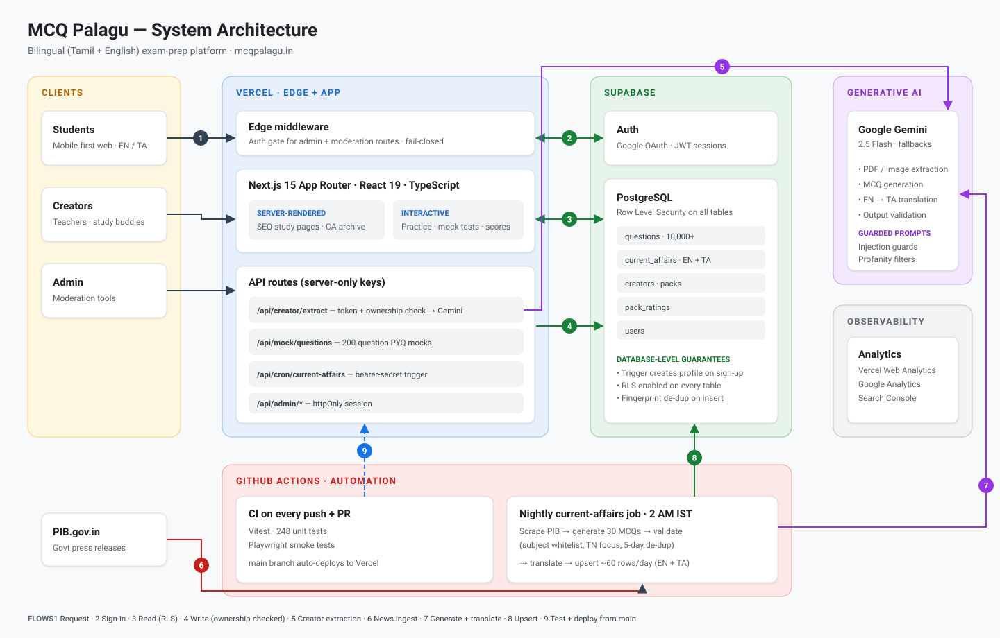

# MCQ Palagu

[](https://github.com/MuthuselviG/vaagai/actions/workflows/ci.yml)

**Live:** [mcqpalagu.in](https://mcqpalagu.in)

A bilingual (Tamil + English) MCQ practice platform for Tamil Nadu government exam aspirants — TNPSC Group 2 / Group 4, TET and TNUSRB. Mobile-first, built and run solo end to end.

- **10,000+** Samacheer Kalvi questions (Class 6–10)
- **1,800+** previous-year questions (2012–2025)
- **~30** auto-generated bilingual current-affairs questions every day
- Expert-created question packs from verified creators

---

## Architecture

<p align="center"></p>

Detailed diagrams — ingestion pipeline, current-affairs automation, auth flow, practice sessions, creator uploads and the full database schema — are in [`docs/ARCHITECTURE.md`](docs/ARCHITECTURE.md).

---

## Engineering highlights

- **Automated content pipeline.** A nightly GitHub Actions job scrapes PIB press releases, generates MCQs with Gemini, validates each batch (subject whitelist, Tamil Nadu focus, de-duplication against the last 5 days), translates to Tamil, and upserts ~60 rows (EN + TA) per day with no manual work.
- **AI-assisted creator uploads.** Creators upload text, images or PDFs; Gemini extracts or generates MCQs, which are validated and stored against the creator's pack. The endpoint requires a Supabase session and verifies creator and pack ownership before any AI call or write.
- **Bilingual rendering.** Tamil and English throughout, with language preference synced between local storage and the user profile. Question rendering handles assertion–reason, match-the-list and multi-statement formats.
- **Reliable test sessions.** Question order is fixed per session at the database level so results and reviews stay consistent.
- **Data integrity at the database layer.** A Postgres trigger creates the user profile row on sign-up, replacing a client-side insert that was silently failing for a majority of new users.
- **Operational learning.** A redirect loop between an app-level redirect and a platform-level domain redirect once took the site offline for 34.5 hours. The postmortem and the resulting guardrail (always inspect live redirect behaviour before adding one) are documented in the repo.

---

## Tech stack

| Layer | Tool |
|-------|------|
| Frontend | Next.js 15 (App Router), React 19, TypeScript |
| Database & auth | Supabase — PostgreSQL, Row Level Security, Google OAuth |
| AI | Google Gemini 2.5 Flash |
| Hosting | Vercel |
| Automation | GitHub Actions |
| Testing | Vitest (248 unit tests), Playwright (smoke) |
| Analytics | Vercel Analytics, Google Analytics |

---

## Project structure

```
vaagai/
├── frontend/            # Next.js app (deploy target)
│   ├── app/             # App Router pages and API routes
│   ├── components/      # Shared React components
│   ├── lib/             # Data access, design tokens, session, utils
│   ├── scripts/         # current-affairs.ts (nightly cron)
│   ├── __tests__/       # Vitest unit tests
│   └── e2e/             # Playwright smoke tests
├── supabase/            # SQL schema and session-consistency rules
├── docs/                # Architecture diagrams
└── .github/workflows/   # CI + nightly current-affairs job
```

---

## Running locally

```bash
cd frontend
npm install
# create .env.local with the variables listed below
npm run dev                  # http://localhost:3000
```

```bash
npm test          # unit tests
npm run test:e2e  # Playwright smoke tests
npm run lint
```

### Environment variables

| Variable | Purpose |
|----------|---------|
| `NEXT_PUBLIC_SUPABASE_URL`, `NEXT_PUBLIC_SUPABASE_ANON_KEY` | Supabase client |
| `SUPABASE_SERVICE_ROLE_KEY` | Server-only DB access |
| `GEMINI_API_KEY` | Creator uploads |
| `GEMINI_API_KEY_CRON` | Nightly current-affairs job |
| `CRON_SECRET` | Bearer token for the cron endpoint |
| `ADMIN_EMAIL`, `ADMIN_PASSWORD` | Admin dashboard login |
