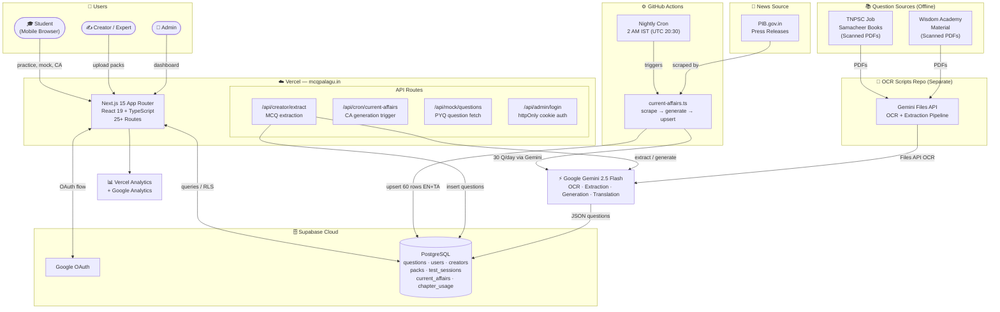
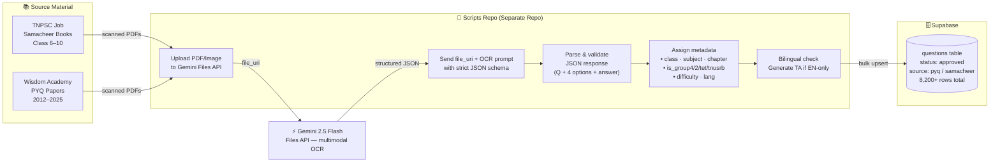
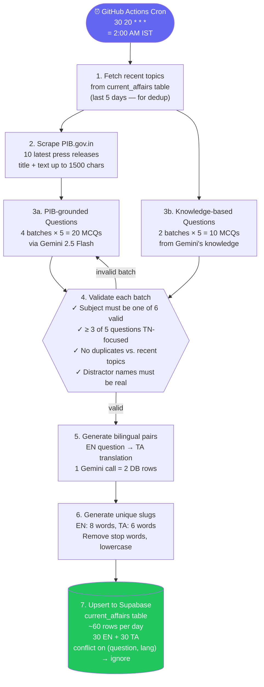
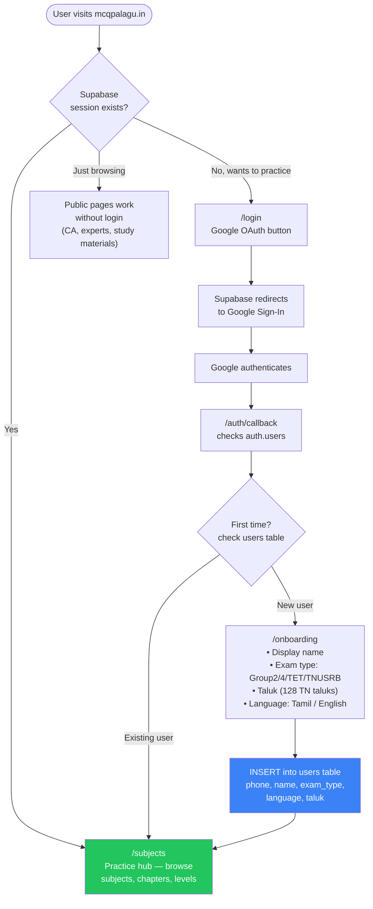
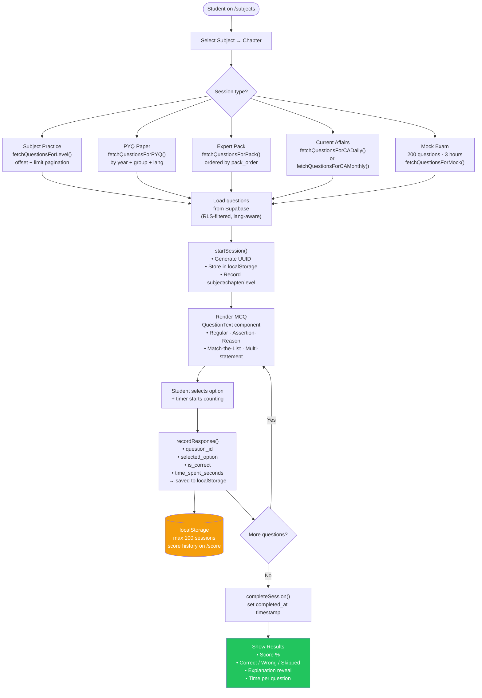
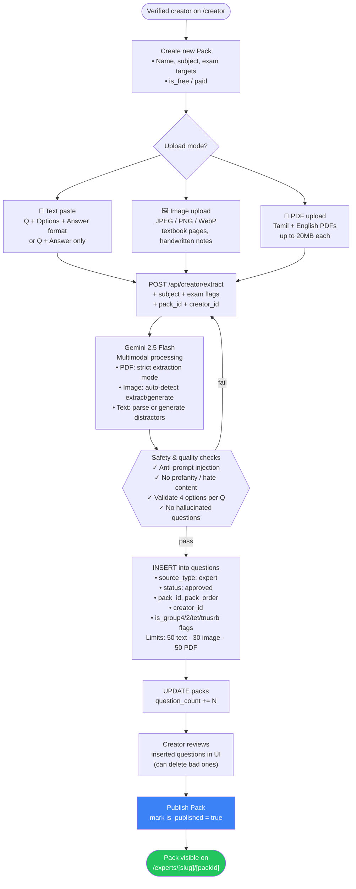
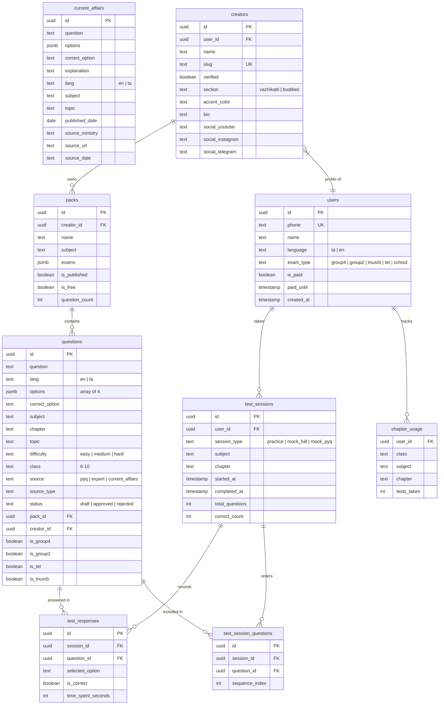
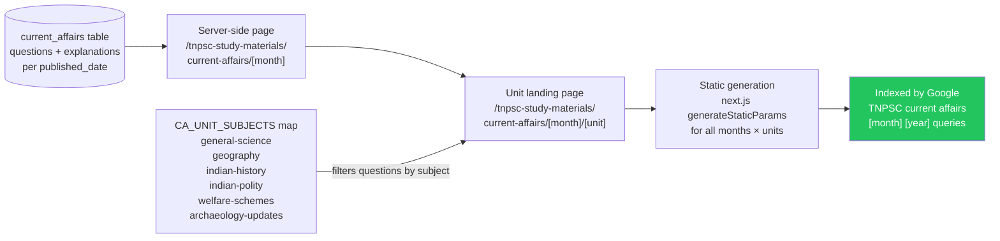

# MCQ Palagu — Architecture Diagrams

> Platform: **mcqpalagu.in** — Bilingual (Tamil + English) MCQ practice for TNPSC Group 2/4, TET, TNUSRB aspirants.

---

## 1. Overall System Architecture

High-level view of every major component and how they connect.

---

## 2. Question Ingestion — OCR Pipeline (Separate Repo)

How the **6,400+ Samacheer Kalvi questions** (Class 6–10) and **1,800+ PYQ questions** got into the database.

---

## 3. Daily Current Affairs Automation

How **~30 bilingual MCQs/day** are auto-generated and stored without any manual work.

**Valid subjects (hardcoded):** General Science · Geography · History · Indian Polity · Economy · General Tamil

---

## 4. User Auth & Onboarding Flow

---

## 5. Practice Session Flow

How a student goes from subject selection to a scored result — entirely client-side state via `localStorage`.

---

## 6. Creator Upload Flow

How a verified creator builds and publishes an expert question pack.

---

## 7. Database Schema

Tables, columns, and relationships at a glance.

---

## 8. Feature: Current Affairs Study Pages (SEO)

How CA questions become SEO-indexed study material at `/tnpsc-study-materials/`.

---

## Route Map

| Route | Auth | Description |
|-------|------|-------------|
| `/` | No | Landing — featured packs, CA promo, creator CTA |
| `/subjects` | Yes | Browse subjects → chapters → levels |
| `/practice/[subject]/[chapter]` | Yes | Timed MCQ session with flag + explanation |
| `/mock` | Yes | Mock test landing — year selection |
| `/mock/[year]` | Yes | 200-question mock (3 hours) |
| `/mock/[year]/result` | Yes | Results and answer review |
| `/pyq/[group]/[year]` | Yes | PYQ paper — Tamil + General Studies |
| `/current-affairs` | No | Daily CA browser — calendar view |
| `/tnpsc-study-materials/current-affairs/[month]/[unit]` | No | SEO CA unit detail |
| `/experts` | No | Browse verified creators + packs |
| `/experts/[slug]/[packId]` | No | Expert pack detail + practice |
| `/creator` | Yes + verified | Creator dashboard — manage packs |
| `/admin-fun-panrom` | Admin cookie | Admin dashboard |
| `/onboarding` | Yes | Name, exam type, taluk setup |
| `/score` | Yes | User score history |
| `/login` | No | Google OAuth |
| `/auth/callback` | — | OAuth redirect handler |
